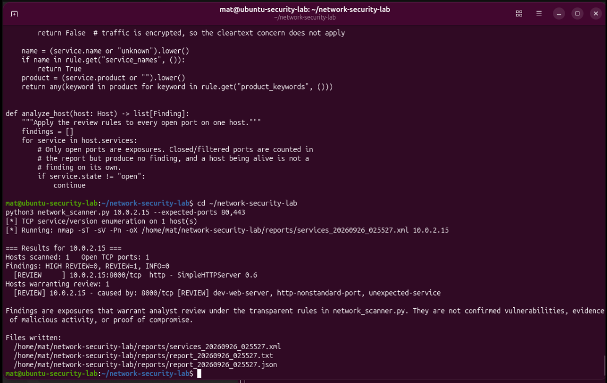
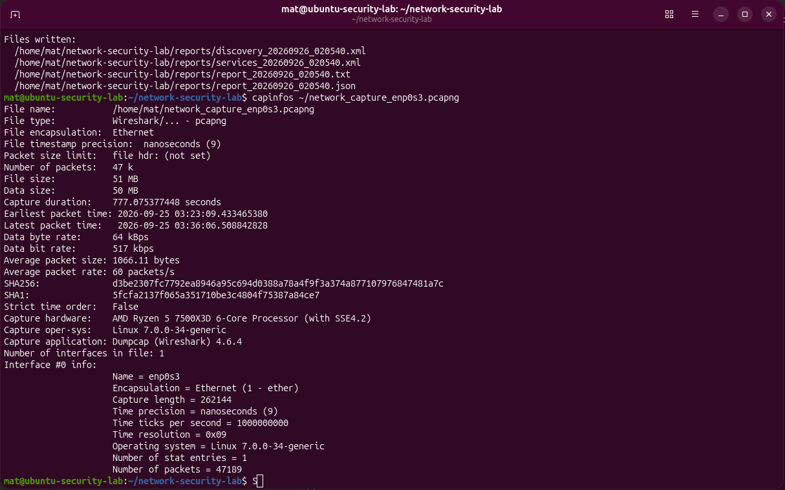
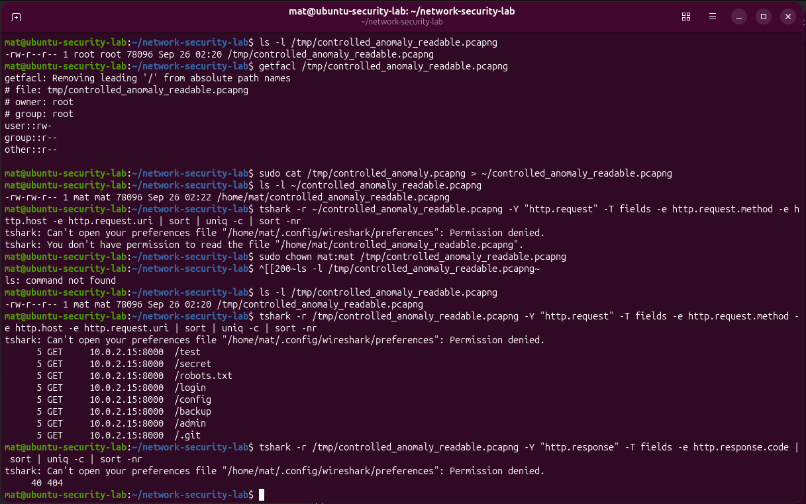

# Network Security & Threat Analysis Lab
I built this lab to get hands-on experience with network traffic analysis, service enumeration, exposure review, and Python-based security automation using Wireshark, Nmap, and Linux.
## Key Results

- Captured and analyzed 47,189 network packets
- Reviewed TCP, DNS, HTTP, TLS, ICMP, UDP, and QUIC traffic
- Built a Python scanner for host discovery, service enumeration, and exposure review
- Added analyst-defined expected-port baseline checks
- Added host-level REVIEW assessments
- Generated TXT, JSON, and XML reports
- Completed a controlled HTTP anomaly investigation
- Finished with 58 passing offline unit tests

## Project Evidence

### Final Scanner Validation

The final validation identified an HTTP service on TCP port 8000 and flagged it for review based on the development server, nonstandard HTTP port, and expected-service baseline.

### Packet Capture Analysis

The main packet capture contained 47,189 packets and included traffic across TCP, DNS, HTTP, TLS, ICMP, UDP, QUIC, and other protocols.

### Controlled HTTP Investigation

A controlled test generated repeated requests to sensitive-looking paths such as `/admin`, `/login`, `/backup`, and `/.git`, which were captured and investigated as unusual request behavior.

## Overview

This lab was built to get hands-on experience with network traffic analysis, service discovery, exposure review, and Python-based security automation.

I used Ubuntu, Wireshark/TShark, Nmap, and Python to capture and analyze traffic, identify open services, review unusual exposures, and automate parts of the analysis process.

The lab includes:

- Packet capture and protocol analysis
- Host discovery
- TCP port and service enumeration
- Nmap XML parsing
- Rule-based exposure review
- Expected-service baseline checks
- Host-level review
- TXT, JSON, and XML reporting
- Offline unit testing
- Controlled anomaly investigation

The scanner is designed to flag activity that needs further review. It does not label a system as malicious, compromised, or vulnerable.

## Tools

- Python
- Ubuntu Linux
- Nmap
- Wireshark
- TShark
- TCP/IP
- DNS
- HTTP
- TLS
- ICMP
- XML
- JSON
- Python unittest

## Lab Setup

The lab was built inside an Ubuntu VM running in Oracle VirtualBox.

Main lab host:

10.0.2.15

I intentionally started a Python HTTP server on TCP port 8000 so I had a controlled service to discover and analyze.

python3 -m http.server 8000

All scans were performed only against my own lab environment.

## Packet Analysis

Wireshark and TShark were used to capture and inspect network traffic from the Ubuntu VM.

The main capture contained:

47,189 packets
About 50 MB of traffic

Protocols observed included:

- TCP
- DNS
- HTTP
- TLS
- ICMP
- UDP
- QUIC
- NTP
- ARP

The capture included more than 45,000 TCP packets and thousands of TLS packets.

### DNS

I reviewed DNS queries and responses generated by the VM.

Examples included traffic related to:

- google.com
- connectivity-check.ubuntu.com
- Mozilla services

### HTTP

I inspected HTTP requests, hosts, URIs, and responses.

Because the browser and Python HTTP server were running on the same VM, the port 8000 traffic stayed on the loopback interface instead of the main enp0s3 interface.

Example traffic included:

HTTP GET /
HTTP/1.0 200 OK
Host: 10.0.2.15:8000

### ICMP

I also reviewed ICMP echo request and reply traffic to look at basic network reachability behavior.

## Controlled Anomaly Investigation

I created a controlled HTTP traffic scenario by repeatedly requesting sensitive-looking paths from the local Python web server.

Examples:

- /admin
- /login
- /backup
- /config
- /.git
- /robots.txt
- /secret
- /test

The capture contained 40 HTTP requests from this test.

I then checked the responses and confirmed that all 40 returned HTTP 404.

This gave me a simple way to practice identifying unusual request patterns and investigating them without assuming the activity was malicious.

## Python Network Scanner

The project includes a custom Python scanner:

network_scanner.py

The scanner automates:

- Host discovery
- TCP service and version enumeration
- Nmap XML parsing
- Rule-based exposure review
- Expected-port baseline checks
- Host-level review
- Report generation

## Scanner Workflow

Authorized Target
        |
        v
Host Discovery
        |
        v
TCP Service and Version Enumeration
        |
        v
Nmap XML Parsing
        |
        v
Rule-Based Exposure Review
        |
        v
Expected-Service Baseline Check
        |
        v
Host-Level Assessment
        |
        v
TXT / JSON / XML Reports

## Safety Controls

The scanner restricts targets to:

- RFC1918 private IPv4 addresses
- Loopback addresses
- Networks no larger than /24

Public Internet targets are rejected.

This helps keep the scanner limited to controlled or authorized environments.

## Service Enumeration

Nmap is used for TCP service and version detection.

The scanner uses options including:

-sT
-sV
-Pn

Instead of scraping terminal output, the scanner parses Nmap XML.

The parsed data includes:

- Host IP
- Hostname
- Port
- Protocol
- Port state
- Service name
- Product
- Version

## Exposure Review

Open TCP services are checked against transparent review rules.

Examples include:

- Development web servers
- HTTP on nonstandard ports
- Plaintext remote login services
- Other services that may need analyst review

Closed and filtered ports do not create exposure findings.

A finding means the service should be reviewed further. It does not prove that the service is malicious or vulnerable.

## Expected-Service Baseline

The scanner can also compare open ports against an analyst-defined baseline.

Example:

python3 network_scanner.py 10.0.2.15 --expected-ports 80,443

In this example, ports 80 and 443 are treated as the expected TCP services.

If another open port is found, it receives an additional:

unexpected-service

review reason.

If no baseline is provided, this check is skipped.

## Host-Level Review

Port-level findings are also rolled up into a host-level assessment.

A host receives REVIEW when one or more of its services already have REVIEW or HIGH REVIEW findings.

The host-level result lists the findings that caused the review.

A host being online by itself does not create a finding.

## Final Validation

The final validation scan was run against:

10.0.2.15

with this expected-port baseline:

80,443

Command:

python3 network_scanner.py 10.0.2.15 --expected-ports 80,443

The scanner found:

Host: 10.0.2.15
Open TCP ports: 1
Port: 8000/tcp
Service: HTTP
Product: SimpleHTTPServer 0.6

Port 8000 received a REVIEW classification for:

- dev-web-server
- http-nonstandard-port
- unexpected-service

The host also received a host-level REVIEW because that service generated review-worthy findings.

This result does not mean the host was compromised. It means the exposure should be reviewed.

## Reports

The scanner produces:

- Nmap XML
- TXT report
- JSON report
- Terminal summary

The final validation reports are stored in:

evidence/final_reports/

Files:

- report_20260926_025527.json
- report_20260926_025527.txt
- services_20260926_025527.xml

## Testing

The project includes:

test_network_scanner.py

The tests use synthetic Nmap XML, so the test suite can run without performing real network scans.

Final result:

58 passing tests

The tests cover:

- Private and loopback target validation
- Public target rejection
- Network-size restrictions
- Port parsing
- Nmap XML parsing
- Open, closed, and filtered port handling
- Service review rules
- Expected-port baselines
- Unexpected-service detection
- Host-level review
- JSON output
- Text output
- CLI behavior
- Safety wording

The tests also make sure the scanner does not incorrectly claim:

- Malicious activity
- Compromise
- Infection
- Exploitation
- Confirmed vulnerabilities

## Project Structure

network-security-lab/
|
|-- network_scanner.py
|-- test_network_scanner.py
|-- README.md
|
|-- reports/
|
|-- evidence/
|   |-- pcaps/
|   |   `-- network_capture_enp0s3.pcapng
|   |
|   |-- screenshots/
|   |
|   `-- final_reports/
|       |-- report_20260926_025527.json
|       |-- report_20260926_025527.txt
|       `-- services_20260926_025527.xml
|
`-- docs/

## What I Practiced

This lab gave me hands-on experience with:

- Network traffic analysis
- TCP/IP
- DNS investigation
- HTTP analysis
- TLS traffic identification
- Host discovery
- Port scanning
- Service enumeration
- Exposure review
- Security baselining
- Anomaly investigation
- Python automation
- Security reporting

## Limitations

A few limitations of the current version:

- The scanner focuses on TCP services
- UDP service enumeration is not included
- Nmap service fingerprints can be inaccurate
- Nmap uses the default top 1000 TCP ports unless a custom range is provided
- The expected-port baseline applies to the full assessment instead of having a separate baseline for every host
- The scanner does not perform CVE lookups
- The scanner does not exploit services
- The scanner does not prove that a host is compromised
- Scanning the VM from itself mainly shows what is listening locally and does not prove what another machine could reach through external firewall or network controls

## Responsible Use

This lab was built for cybersecurity learning and authorized testing.

Only scan systems and networks that you own or have permission to assess.
